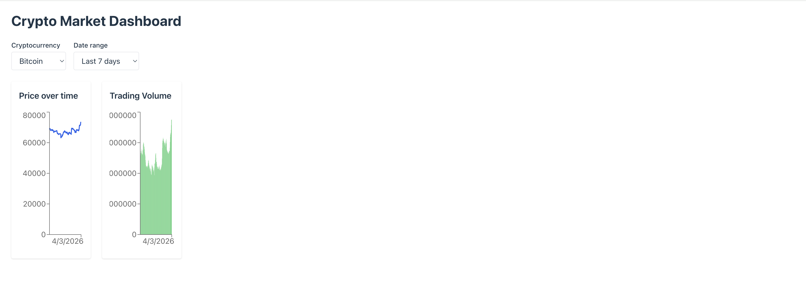
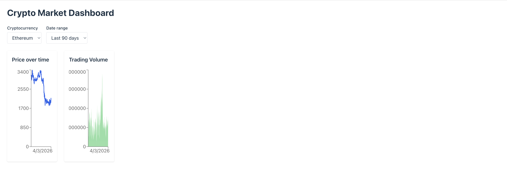
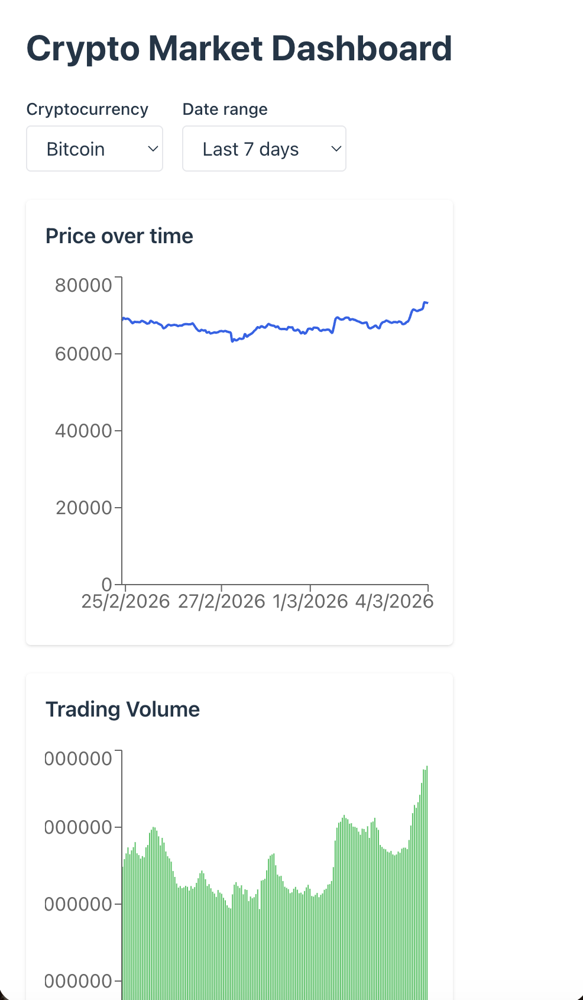

# 📊 Crypto Market Dashboard

Interactive dashboard built with React and TypeScript to visualize real-time cryptocurrency market data using the CoinGecko public API.

---

## 🛠 Tech Stack

- React + TypeScript
- Vite
- Tailwind CSS
- Recharts
- CoinGecko Public API
- Jest + React Testing Library
- Vercel (deployment)

---

## ✨ Features

- 📈 Line chart showing cryptocurrency price over time
- 📊 Bar chart displaying trading volume
- 🔄 Dynamic filters (cryptocurrency & date range)
- ♿ Accessible UI (ARIA roles, keyboard navigation)
- 📱 Responsive design (mobile-first)
- ⚠️ Error and loading state handling
- 🧪 Unit tests for key components

---

## 📦 How to run the project
Install dependencies
```
npm install
```

Run development server
```
npm run dev
```

Run tests
```
npm test
```

## 📸 Screenshots

### Initial Load


### Filters Applied


### Mobile View


## Exploración de mercado

El dashboard presenta métricas del periodo, precio y volumen en paneles que ocupan el ancho disponible. Los ejes usan valores abreviados y el detalle conserva valores completos. Los filtros siguen disponibles durante la carga y los errores; se cancelan solicitudes reemplazadas y nunca se muestra una respuesta anterior bajo los filtros nuevos. Se informa el límite de consultas de CoinGecko y se permite reintentar.

Los datos provienen de CoinGecko; se indica la fecha de la observación más reciente y la hora de consulta. Ejecuta `npm run test` para los componentes, `npm run test:api` para validación de datos y errores (Node.js 22 o posterior), `npm run build` y `npm run lint`.
